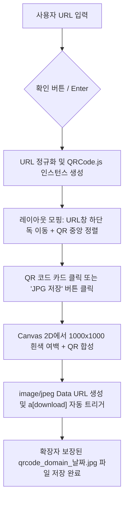

# QR Studio (URL2QR) 구현 계획 · 워크스루 · 작업 목록

본 문서는 사용자의 요청에 따라 구축된 **URL2QR (QR Studio)** 웹 애플리케이션의 구현 계획, 사용자 인터랙션 흐름(워크스루), 그리고 완료된 세부 작업 목록을 정리한 종합 가이드입니다.

---

## 1. 구현 계획 (Implementation Plan)

### 1.1 프로젝트 목표
- **심플하고 직관적인 QR 생성 웹 서비스**: 누구나 손쉽게 URL을 입력하면 즉시 고품질 QR 코드를 생성.
- **다이내믹 모핑 레이아웃 (Morphing Layout)**: 확인 버튼을 누르면 URL 입력창이 하단 플로팅 독(Dock)으로 부드럽게 이동하고, 화면 정중앙에 QR 코드가 생성·배치되는 프리미엄 인터랙션 구현.
- **신뢰할 수 있는 고화질 JPG 다운로드**: QR 코드 클릭 시 1000×1000px 고화질 `.jpg` 파일로 즉시 저장.
- **브랜드 로고 조화 및 마우스 반응형 그라데이션**: 노란색 [`logo.png`](file:///c:/2026/sdu/바이브코딩/프로젝트04/img/logo.png)와 완벽히 어울리는 밝고 따뜻한 톤과 마우스 커서 위치(X, Y)에 반응하는 실시간 그라데이션 광원 효과 구축.

### 1.2 아키텍처 및 기술 스택
| 계층 | 사용 기술 | 역할 및 특징 |
| :--- | :--- | :--- |
| **구조 (Structure)** | Semantic HTML5 | 접근성(ARIA)을 준수한 마크업, SEO 최적화 메타 태그 |
| **스타일링 (Styling)** | Vanilla CSS | CSS 변수 기반 테마, 글래스모피즘, 60fps 스프링 트랜지션 |
| **로직 (Logic)** | Vanilla JavaScript (ES6+) | QR 생성 엔진, Canvas JPG 렌더링, Lerp 커서 트래킹 |
| **로컬 서버 (Server)** | Node.js Built-in `http` | 무캐시(No-cache) 헤더 제공, 3000번 포트 경량 로컬 서버 |

---

## 2. 워크스루 (Walkthrough & User Journey)

### Step 1. 초기 진입 화면 (밝고 따뜻한 톤 & 마우스 반응)
- 페이지에 접속하면 상단 좌측에 노란색 [`URL2QR 로고`](file:///c:/2026/sdu/바이브코딩/프로젝트04/img/logo.png)가 고급스러운 라운드 섀도와 함께 위치합니다.
- 배경은 따뜻한 아이보리와 허니 골드 빛의 앰비언트 광원이 부드럽게 깔려 있습니다.
- **마우스 커서 인터랙션**: 마우스 커서를 화면 위에서 이동하면 커서의 위치(X, Y)에 따라 실시간으로 배경 아우라의 중심점과 그라데이션 색조(Hue: 앰버 골드 ↔ 선셋 오렌지 ↔ 코랄)가 유기적으로 변화합니다.

### Step 2. URL 입력 및 편의 도구
- 화면 정중앙의 글래스모피즘 검색창에 변환하고 싶은 웹사이트 주소를 입력합니다.
- **클립보드 붙여넣기 (`붙여넣기` 버튼)**: 한 번의 클릭으로 클립보드에 있는 링크를 바로 입력창에 삽입.
- **빠른 테스트 칩 (`Google`, `Naver`, `YouTube`, `GitHub`)**: 주소를 직접 타이핑하지 않고도 클릭 한 번으로 인기 사이트 QR 즉시 테스트 가능.

### Step 3. 레이아웃 모핑 및 QR 코드 중앙 배치
- URL을 입력하고 **[확인]**을 누르거나 빠른 칩을 누르면:
  1. 중앙에 있던 URL 입력바가 화면 하단의 플로팅 독(Floating Dock)으로 매끄럽게 내려갑니다.
  2. 화면 정중앙에 고대비의 QR 코드 카드가 입체적인 그림자와 함께 선명하게 등장합니다.
  3. QR 카드 상단에 `"QR 코드를 클릭하면 JPG 파일로 다운로드됩니다"` 플로팅 안내 힌트가 부드럽게 깜빡입니다.

### Step 4. 고화질 JPG 다운로드
- 생성된 **QR 코드 카드를 마우스로 클릭**하거나, 하단의 **[JPG 파일 저장]** 버튼을 누릅니다.
- 내부적으로 오프스크린 캔버스(`1000×1000px`, 스캔 안전 여백 `120px` 포함)를 통해 순수 흰색 배경에 초고화질로 렌더링된 뒤, `image/jpeg` 포맷으로 즉시 다운로드됩니다.
- 다운로드되는 파일명은 링크 도메인과 생성 날짜를 조합한 형식(`qrcode_naver_com_20261021.jpg`)으로 확장자가 100% 보장되어 저장됩니다.

---

## 3. 세부 작업 목록 (Task List & Status)

### 📌 1단계: 레이아웃 및 핵심 기능 구현 (완료)
- [x] 화면 상단 좌측에 [`img/logo.png`](file:///c:/2026/sdu/바이브코딩/프로젝트04/img/logo.png) 배치 및 인터랙티브 호버 스타일 적용
- [x] 화면 중앙에 직관적인 URL 입력 폼 및 빠른 테스트 칩(Naver, Google 등) 구현
- [x] 확인 시 URL 입력창이 화면 하단으로 내려가고 정중앙에 QR 코드가 모핑되는 CSS/JS 상태 전환 시스템 구축
- [x] QR 코드 클릭 시 즉각적인 반응형 축소 피드백(Scale 애니메이션) 제공

### 📌 2단계: JPG 다운로드 엔진 고도화 및 확장자 보장 (완료)
- [x] 브라우저 Blob URL의 UUID 다운로드 이슈(확장자 탈락 현상) 분석 및 해결
- [x] 캔버스 기반 고해상도(`1000×1000px`) JPEG Data URL 변환 방식 채택
- [x] 크롬 다운로드 매니저 파일명 인식 보장을 위한 300ms 안전 디스패치 적용
- [x] 캐시 방지 쿼리스트링(`app.js?v=4`) 및 서버 무캐시 헤더 적용

### 📌 3단계: 로고 맞춤 밝은 톤 및 커서 반응형 그라데이션 (완료)
- [x] 기본 테마를 로고와 조화를 이루는 따뜻한 밝은 톤(`light`)으로 전환
- [x] 따뜻한 아이보리 베이스(`--bg-primary: #fffdf9`)와 허니 골드(`--accent-primary: #f59e0b`) 색상 토큰 체계 완성
- [x] `requestAnimationFrame` + Lerp 감속 보간(Damping: 0.08)을 이용한 60fps 부드러운 커서 트래킹 구현
- [x] 커서 X/Y 좌표에 연동되는 HSL 동적 색조 변수(`--cursor-hue-1`, `--cursor-hue-2`, `--cursor-hue-3`) 및 배경 오라(`mouse-glow-canvas`) 적용
- [x] 메인 타이틀의 그라데이션 텍스트 및 확인 버튼에도 커서 반응형 그라데이션 동기화

---

## 4. 소스 코드 파일 맵

- **마크업**: [index.html](file:///c:/2026/sdu/바이브코딩/프로젝트04/index.html)
- **스타일 시트**: [css/style.css](file:///c:/2026/sdu/바이브코딩/프로젝트04/css/style.css)
- **프론트엔드 로직**: [js/app.js](file:///c:/2026/sdu/바이브코딩/프로젝트04/js/app.js)
- **로컬 웹 서버**: [server.js](file:///c:/2026/sdu/바이브코딩/프로젝트04/server.js)
- **원클릭 실행 파일**: [실행하기.bat](file:///c:/2026/sdu/바이브코딩/프로젝트04/실행하기.bat)
